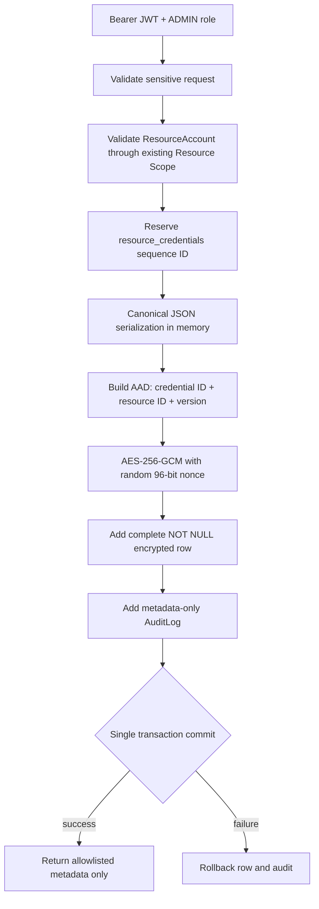

# V1.2-M1 C2 Credential Management Backend Closure Report

日期：2026-10-08  
Gate：C2 — Credential Management Service + HTTP API  
结论：**PASS**

## 1. C2 范围与完成状态

本 Gate 已完成 ResourceCredential 后端管理闭环：创建、分页列表、元数据详情、元数据修改、加密凭据轮换、状态修改、ResourceAccount 关联校验、Resource Scope 查询隔离、ADMIN 写权限、同事务审计、安全错误响应和自动化测试。

本 Gate 未实现且未越界实现：Grant 管理、Secret Reveal、recent re-auth、凭据通知、导出、前端页面、C3/C4/C5 功能。没有修改 V1.1 冻结业务边界。

| 范围 | 状态 |
| --- | --- |
| Credential create/list/detail/update | PASS |
| Secret rotate | PASS |
| Status management | PASS |
| ResourceAccount relation validation | PASS |
| JWT / Role / Resource Scope | PASS |
| Audit / transaction | PASS |
| Sensitive validation and response boundary | PASS |
| Grant / Reveal / re-auth | DEFERRED TO C3 |
| Notification | DEFERRED TO C4 |
| Frontend / restore closure | DEFERRED TO C5 |

## 2. 新增或修改文件

```text
backend/app/main.py
backend/app/api/resource_credentials/__init__.py
backend/app/api/resource_credentials/router.py
backend/app/models/resource_credential.py
backend/app/repositories/resource_credential_repository.py
backend/app/schemas/resource_credential.py
backend/app/security/sensitive_validation.py
backend/app/services/resource_credential_service.py
backend/tests/test_resource_credentials.py
docs/V1.2-M1-C2-CLOSURE-REPORT.md
```

C2 不需要新增 migration；C1 的 `0008_resource_credentials` 已覆盖本 Gate 所需表结构。

## 3. HTTP API 清单

所有接口均要求 Bearer JWT。读取复用现有 Resource Scope；写入仅允许 ADMIN。功能开关关闭时 fail closed，返回 503。

| Method | Path | 权限 | 用途 |
| --- | --- | --- | --- |
| GET | `/api/resource-credentials` | 已登录 + Resource Scope | 分页查询元数据，可按 resource/type/status 过滤 |
| POST | `/api/resource-credentials` | ADMIN | 创建并加密保存凭据 |
| GET | `/api/resource-credentials/{credential_id}` | 已登录 + Resource Scope | 查询元数据详情 |
| PUT | `/api/resource-credentials/{credential_id}` | ADMIN | 修改名称、到期时间、轮换周期 |
| POST | `/api/resource-credentials/{credential_id}/rotate` | ADMIN | 完整性校验后轮换加密 payload |
| PATCH | `/api/resource-credentials/{credential_id}/status` | ADMIN | 修改 ACTIVE / EXPIRED / DISABLED 状态 |

公开响应只包含：ID、ResourceAccount ID、名称、类型、状态、到期/轮换元数据、`has_secret` 和时间戳。响应不包含 plaintext、ciphertext、nonce、key ID、encryption version、User hash 或 Grant。

脱敏创建示例：

```http
POST /api/resource-credentials
Authorization: Bearer <JWT>
Content-Type: application/json

{
  "resource_account_id": 42,
  "credential_name": "Production API Key",
  "secret": {
    "credential_type": "API_KEY",
    "api_key": "<REDACTED>"
  },
  "expires_at": "2027-10-08T00:00:00+08:00",
  "rotation_interval_days": 90
}
```

脱敏响应示例：

```json
{
  "id": 101,
  "resource_account_id": 42,
  "credential_name": "Production API Key",
  "credential_type": "API_KEY",
  "status": "ACTIVE",
  "expires_at": "2027-10-08T00:00:00+08:00",
  "last_rotated_at": "2026-10-08T10:00:00Z",
  "rotation_interval_days": 90,
  "has_secret": true,
  "created_at": "2026-10-08T10:00:00Z",
  "updated_at": "2026-10-08T10:00:00Z"
}
```

轮换请求同样仅接收 `secret` discriminated union，且凭据类型必须与原记录一致。没有 Reveal API。

## 4. 数据库写入与加密流程



创建沿用 C1 sequence ID 预分配方案，避免先写空 payload。轮换先使用记录原 AAD 验证现有 ciphertext 和 active key；错误密钥、key ID 不匹配、nonce/ciphertext/AAD 篡改均统一返回 `409 凭据完整性校验失败`，不会覆盖原密文。

Master Key 仍只从运行环境读取；仓库、数据库、测试报告和响应均未写入真实 key。测试使用进程内随机 32-byte fake key。

## 5. 权限检查与审计

| 场景 | 结果 |
| --- | --- |
| 未登录访问 | 401 |
| BOSS / PM / MEMBER 写操作 | 403 |
| ADMIN 写操作 | 允许，并校验 ResourceAccount |
| GLOBAL 用户读取 | 可见其全局 Resource Scope 内 metadata |
| PM 读取 | 仅 `readable_resources()` 中被管理项目资源 |
| MEMBER 读取 | 仅本人有效分配资源 |
| 猜测跨项目 credential ID | 404，不暴露对象存在性 |
| Scope 外 resource filter | 返回空列表，不能扩大 Scope |

同一事务写入以下 metadata-only 审计动作：

```text
RESOURCE_CREDENTIAL_CREATE
RESOURCE_CREDENTIAL_UPDATE
RESOURCE_CREDENTIAL_ROTATE
RESOURCE_CREDENTIAL_STATUS_UPDATE
```

审计只保存 credential ID/name/type、ResourceAccount ID、status、expires/rotation 元数据。Secret、encrypted payload、nonce、key ID 和请求体均不进入审计。模拟 Audit 写入失败时，Credential row 同事务回滚。

## 6. 自动化测试

开发前实际基线：

```text
236 passed, 1 existing warning
```

C2 新增专项：10 项，全部通过。覆盖：

- 创建、列表、详情、元数据修改、状态修改、轮换；
- 未登录与非 ADMIN 写入拒绝；
- 跨项目读取与 filter 越权拒绝；
- ResourceAccount 不存在；
- 非法敏感参数 422 且不回显 input；
- 同一资源同名冲突 409；
- Audit 异常时事务回滚；
- ciphertext 篡改与错误 Master Key fail secure；
- 数据库、Audit、HTTP response、captured log 明文泄漏检查；
- OpenAPI 无 Reveal，公开响应 schema 无敏感字段；
- feature flag 关闭时 503 fail closed。

最终收集与执行结果：

```text
246 tests collected
246 passed, 1 existing warning
```

唯一 warning 仍为 Starlette TestClient 的既有 anyio alias deprecation。

## 7. C1 与资源管理回归

- C1 的 6 项 encryption/data-model 专项继续通过。
- 原 C1 完整基线 236 项全部继续通过。
- Resource create/update/detail/allocation/scope/security/export 等测试包含在完整回归中并通过。
- `ResourcePublic` 未新增 Credential、Secret 或 cryptographic 字段。
- C2 未改 ResourceAccount 表、Role、Scope、JWT、Project、Expense、Statistics 或 Export 语义。

## 8. Alembic 与开发数据

开发环境只读核对：

```text
Alembic current: 0008_resource_credentials (head)
alembic check: No new upgrade operations detected.
development resource_credentials rows: 0
```

测试只在 `project_cost_hub_test` 执行；`conftest.py` 会拒绝任何名称不含 `test` 的数据库。未向 development 写入测试 Secret。

## 9. Pilot 状态

```text
Pilot Modified: NO
```

本 Gate 未启动 Pilot compose，未连接 Pilot PostgreSQL/API，未 migration、seed、restore、清空、修改账号或写入 Credential/Grant。没有删除或重建任何 Docker 数据卷。

## 10. 风险与遗留问题

- Python 运行时无法保证 immutable string/bytes 的 secure erase；当前控制为缩短 plaintext 生命周期，不记录、不缓存、不落盘。
- 当前为单 active key 模型；多 key/key history 与正式运维轮换不在 C2 范围。
- Development 保持 `RESOURCE_CREDENTIALS_ENABLED=false`，避免在仓库写入 Master Key；部署启用前必须通过外部 secret environment 注入合法 key 和 key ID。
- Grant、recent re-auth 和 Reveal 必须在 C3 独立实现；Resource visibility 仍不等于 Secret reveal permission。
- Expiry/rotation notification 属于 C4，前端 mask/copy 与 restore/key runbook 属于 C5。
- 工作区根目录不是 Git repository，因此无法提供 Git status/diff 证据；本报告文件清单来自实际源码变更。

## 11. C3 进入条件

C2 的服务、API、Resource Scope、加密写入、完整性校验、事务审计与响应边界均已闭合，Alembic 无漂移，完整回归通过，Pilot 未修改。满足进入 C3 的代码与安全前置条件。

C3 必须继续保持以下边界：Grant 主体使用 User；Reveal 强制 Resource Scope + 有效显式 Grant（ADMIN 例外按既定设计）+ recent re-auth；不得复用 C2 metadata 权限作为 Secret reveal 权限；不得在响应、日志或审计中泄漏 plaintext。

## Closure

```text
C2 STATUS: PASS
Credential Service: PASS
HTTP API: PASS
AES-256-GCM / AAD Reuse: PASS
Sequence Preallocation: PASS
JWT / Role / Resource Scope: PASS
Audit Transaction: PASS
Validation Sanitization: PASS
Wrong Key / Tamper: PASS
Plaintext Leak Scan: PASS
Resource API Regression: PASS
Backend Tests: PASS (246 passed)
Alembic Head: 0008_resource_credentials
Pilot Modified: NO
Ready for C3: YES
```
