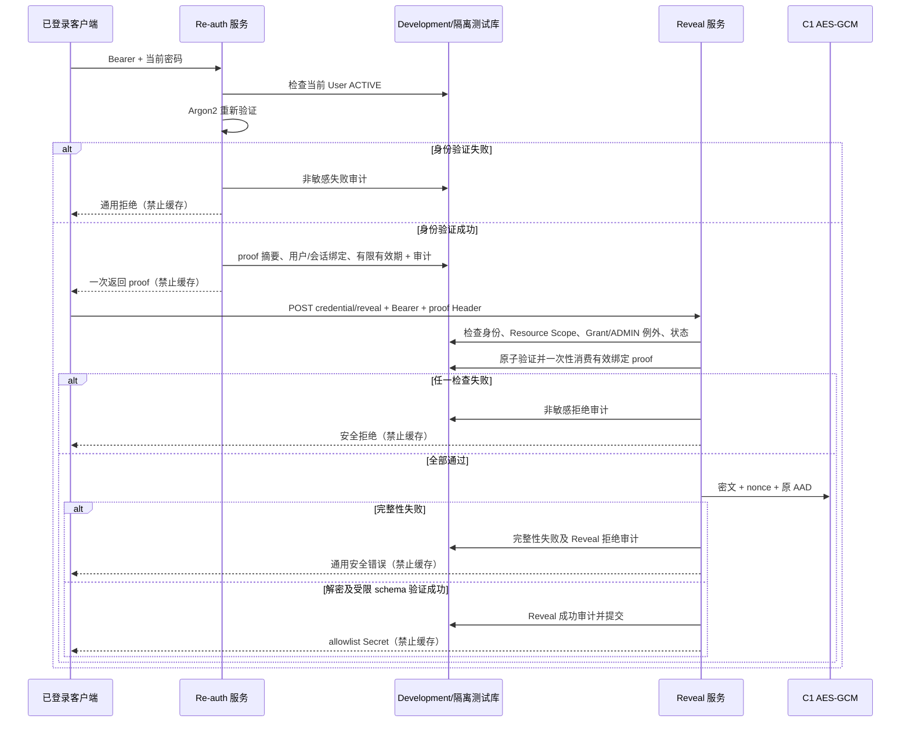

# V1.2-M1-C3 — 凭据授权与安全查看检查报告

> 2026-10-10 Gate 1 复核：**C3 STATUS: BLOCKED**。已实际尝试指定 Development 的 `alembic current` 和完整 `pytest -q --tb=no`，两次均因 Docker daemon 管道不存在失败，pytest 未启动，不能计作 246 passed。Desktop/WSL 已停止；因无法确认 daemon 恢复时继承的 restart policy 不会自动启动 Pilot，本轮未启动 daemon。总体方案仍未找到，已新建待审批草案，明确 JWT 同秒签发碰撞、当前授权会话定义、停用再启用 proof 失效机制等决策。详见 [Gate 1 实测报告](V1.2-M1-C3-GATE1-REPORT.md) 与 [总体方案草案](V1.2-M1-IMPLEMENTATION-PLAN-DRAFT.md)。本轮仅文档变更，未实施 C3、未执行 migration、未修改 Pilot；C4 不可进入。以下为此前检查记录，历史测试结果不代表本次通过。

日期：2026-10-10（Asia/Shanghai）  
项目：企业项目资源与费用管理系统  
**C3 STATUS: BLOCKED**

本报告记录执行前置检查和代码审计，不代表 C3 功能已交付。Grant API、recent re-auth、Reveal 和新增审计尚未实现；未满足安全验收条件，不允许判定 PASS。

## 1. 前置检查与当前架构审计

| 检查 | 本次结果 | 证据与限制 |
| --- | --- | --- |
| C1 Closure Report | 已读取 | `docs/V1.2-M1-C1-ENCRYPTION-DATA-MODEL-REPORT.md`，历史结论 PASS，236 passed |
| C2 Closure Report | 已读取 | `docs/V1.2-M1-C2-CLOSURE-REPORT.md`，历史结论 PASS，246 passed |
| V1.2-M1 总体实施方案 | 未找到，阻塞 | 项目文件名检索及 Markdown/TXT 内容检索未发现独立总体方案；已请求提供路径。C0 审计不能冒充总体方案 |
| 真实安全代码 | 已只读审阅 | 见下述文件与结论 |
| C2 基线 246 passed 实测 | 未验证，阻塞 | Docker daemon 不可用，不能将历史报告结果当成本次执行结果 |
| 开发库 Head `0008_resource_credentials` | 运行态未验证，阻塞 | 源码 migration 为该 revision；本机 55432 端口不可连接 |
| Pilot 隔离 | 配置层确认，运行态未确认 | overlay 指向独立库及 55433；daemon 不可用，无法确认容器、网络和 volume 实际隔离 |

审阅文件及现状：

- `backend/app/models/user.py`、`role.py`：认证主体为 User，Employee 可空。Grant 的用户及授予者外键均指向 `users.id`。
- `backend/app/permissions/dependencies.py`：JWT 解码后重新读取 User/Role/Employee 并检查 ACTIVE。C3 不应改变冻结 JWT 结构或现有角色行为。
- `backend/app/core/security.py`、`services/auth_service.py`：集中 Argon2 密码验证；JWT 无 jti 和独立服务器会话。现有登录时间不能代替 recent re-auth。
- `backend/app/permissions/roles.py`、`scopes.py`、`resource_scope.py`：ADMIN/BOSS 为 GLOBAL；PM 使用所管理项目的有效资源分配；MEMBER 限本人有效分配及参与项目。没有 Employee 的非 GLOBAL 用户无资源 Scope。
- `backend/app/models/resource_credential.py`、`resource_credential_grant.py`：Credential 独立加密表；Grant 唯一键为 `(credential_id, user_id)`，已有有效期、撤销、can_reveal；尚无 HTTP 授权管理或判定服务。
- `backend/app/services/resource_credential_service.py`、`api/resource_credentials/router.py`、`schemas/resource_credential.py`：现有 C2 管理路由仅返回 allowlist 元数据，读取复用 Resource Scope，写入要求 ADMIN。尚无 Reveal。
- `backend/app/security/credential_encryption.py`、`schemas/credential_secret.py`：AES-256-GCM、随机 96-bit nonce、credential/resource/version AAD，六类受限 Secret schema。现有解密异常为通用安全文本。
- `backend/app/models/audit_log.py`、`services/audit_service.py`、`core/logging.py`、`security/sensitive_validation.py`：已有递归敏感键过滤、显式 credential metadata 审计、敏感参数 422 脱敏；日志未提供可替代权限检查的保证。
- `backend/tests/conftest.py`：测试强制独立 `project_cost_hub_test`，校验库名后重置测试 schema；不能绕过 guard。

已读取 C0 安全审计 `docs/V1.2-M1-C0-RESOURCE-CREDENTIAL-AUDIT.md`。其明确约定 ADMIN 仅免 Grant，仍需 Resource Scope 和 recent re-auth。最终必须与缺失的总体方案核对，不能自行扩大例外。

命令证据：

```text
docker compose ps / docker ps:
failed to connect to the docker API at npipe:////./pipe/dockerDesktopLinuxEngine
open //./pipe/dockerDesktopLinuxEngine: The system cannot find the file specified.

Development port probe:
127.0.0.1:55432 TcpTestSucceeded = False

git status --short:
fatal: not a git repository (or any of the parent directories): .git
```

沙箱命令执行器另有 `helper_unknown_error: setup refresh had errors`，只读审计改用获批的沙箱外命令完成。没有通过替代数据库伪造运行态验证。

## 2. Grant API 清单

**实际交付：无。** 下表仅是待总体方案核对、基线恢复后实现的候选接口，不是当前可调用 API。

| Method | 候选 Path | 权限与要求 |
| --- | --- | --- |
| POST | `/api/resource-credentials/{credential_id}/grants` | ADMIN；目标使用 User ID；检查目标 ACTIVE、Resource Scope、有效期及重复授权 |
| GET | `/api/resource-credentials/{credential_id}/grants` | ADMIN；分页；仅 ID 与授权元数据，不嵌套 User/hash |
| PATCH | `/api/resource-credentials/{credential_id}/grants/{grant_id}` | ADMIN；检查 credential/grant 关联；更新有效期及 can_reveal；无效区间拒绝 |
| POST | `/api/resource-credentials/{credential_id}/grants/{grant_id}/revoke` | ADMIN；撤销并审计；后续 Reveal 必须实时检查撤销状态 |

不得由 Employee 姓名、ResourceAllocation、项目成员关系或 GLOBAL Scope 自动授予 Secret。重复、过期及已撤销记录的重新授权语义须按总体方案落实，不能隐式恢复授权。

## 3. Recent re-auth 方案

**实际交付：无。** 待实施安全方案：

1. 独立敏感路由 `POST /api/auth/re-auth` 要求有效 Bearer CurrentUser；在认证层复用 Argon2 验证当前密码，不把密码传入 Credential Service。
2. 生成至少 256-bit 随机 opaque proof，一次返回；数据库仅保存 SHA-256 digest 和必要会话元数据，禁止保存 raw proof 或密码。
3. 有效期拟为 5 分钟；不使用普通 JWT 的登录时间或过期时间充当二次验证。
4. proof 必须绑定 User 和当前 Bearer 授权会话，绑定值使用不可逆摘要；Reveal 每次重新判定身份、Scope、Grant 和 Credential 状态。
5. proof 通过专用 Header 提交，禁止 URL/query。采用数据库原子一次性消费，确保并发请求最多一个成功；超时、重放、跨用户、跨登录会话必须拒绝。
6. 密码变更和 User 停用须使既有 proof 失效；具体实现须覆盖停用后再启用及改密后的旧 JWT/proof 使用。
7. 成功和失败只审计 User ID、动作、结果及时间；密码、proof、Bearer 值、摘要和身份验证敏感信息均不进入日志或审计。

需新增独立 re-auth 表及线性 migration；上述方案尚未实现、迁移或测试。

## 4. Reveal API 清单

**实际交付：无。** 待实施独立 `POST /api/resource-credentials/{credential_id}/reveal`：

- 按有效身份 → Resource Scope → 有效显式 Grant（ADMIN 仅按既定例外）→ recent re-auth → ACTIVE 且未到期的 Credential → 完整性校验依次判定。
- 服务器端使用 C1 AES-GCM 服务及原 AAD 解密；wrong key、key ID/version 不合法、nonce/ciphertext/AAD 篡改与 payload schema/type 不匹配统一安全拒绝。
- 成功仅返回该类型 allowlist Secret 字段；不返回 ciphertext、nonce、key ID、hash 或 Grant。
- 成功与失败响应均应禁止缓存；拒绝及异常不返回部分明文或底层异常详情。
- 原 C2 元数据 API 响应范围保持不变。

## 5. 完整权限矩阵（目标规则，尚未验证）

| 角色/场景 | 元数据 | Grant 管理 | Reveal |
| --- | --- | --- | --- |
| 未登录、无效 JWT、User 非 ACTIVE | 拒绝 | 拒绝 | 拒绝 |
| ADMIN | GLOBAL Resource Scope | 允许 | Scope + recent re-auth + Credential 可查看；C0 仅允许免 Grant |
| BOSS | GLOBAL Resource Scope | 拒绝 | Scope + 有效显式 Grant + recent re-auth + Credential 可查看 |
| PROJECT_MANAGER | 现有 MANAGED_PROJECTS Scope | 拒绝 | Scope + 有效显式 Grant + recent re-auth + Credential 可查看 |
| MEMBER | 现有本人有效分配 Scope | 拒绝 | Scope + 有效显式 Grant + recent re-auth + Credential 可查看 |
| 非 GLOBAL 且无 Employee 映射 | 无可读资源 | 拒绝 | 拒绝 |
| 有 Grant、无 Resource Scope | 不可见 | 非 ADMIN 拒绝 | 拒绝 |
| 有 Scope、无 Grant（非 ADMIN） | 可见 | 拒绝 | 拒绝 |
| Grant 未开始、过期、撤销或 can_reveal=false | Scope 内可见 | ADMIN 可按方案管理 | 非 ADMIN 拒绝 |
| proof 缺失、过期、已消费、跨用户/会话 | Scope 内可见 | 按角色 | 所有角色拒绝 |
| Credential EXPIRED、DISABLED 或实际已到期 | 按 C2 Scope | 按方案 | 所有角色拒绝 |
| 密文完整性/解密失败 | 按 C2 Scope | 按方案 | 所有角色安全拒绝并审计 |
| 项目成员/资源分配关系本身 | 仅影响现有 Scope | 不产生自动 Grant | 不产生 Secret 权限 |

## 6. 二次验证与 Reveal 时序图（待实施）



必须通过真实测试验证事务与审计失败行为；图示不能当作实现或安全证据。

## 7. 数据库迁移信息

- 已审阅源码 `backend/alembic/versions/0008_resource_credentials.py`，父 revision 为 `0007_resource_name_unique`，创建 Credential/Grant 两表及约束。
- C2 报告历史开发库 Head 为 `0008_resource_credentials`；本次未连接成功，不能确认现状。
- C3 本次没有新增或执行 migration，没有升级、降级、重置数据库。
- 后续仅允许 Development 和隔离测试库的独立 re-auth migration；Pilot 禁止迁移。

## 8. 审计与敏感信息防泄漏结果

已有 C1/C2 静态边界已审阅，但 C3 尚无实现或运行证据。待实现动作包含 Grant 创建/修改/撤销、re-auth 成功/失败、Reveal 成功/拒绝、越权和完整性失败。

C3 Audit payload 应显式选择 User ID、Credential ID、Grant ID、动作、结果、时间等非敏感字段；不记录请求体、明文、密码、proof、ciphertext、nonce、Master Key 或异常 payload。

本次没有调用 Secret API、读取真实 Master Key 或数据库密文，没有写入任何 Secret、认证 proof 或业务记录。没有修改 C2 响应 schema。本次仅可声明静态审阅完成，不能声明 C3 泄漏测试通过。

## 9. 自动化测试结果

```text
C2 历史报告：246 passed, 1 existing warning
本次 C2 基线实测：NOT RUN / BLOCKED
C3 专项测试：NOT IMPLEMENTED / NOT RUN
C1/C2 完整回归：NOT RUN / BLOCKED
```

Docker daemon 不可用，Development PostgreSQL 端口不可达。未更换到 SQLite 或放宽隔离 guard 来规避条件。

解除阻塞后必须覆盖用户要求的全部 11 类场景，并追加并发 proof 消费、跨登录会话、User 停用/改密、ADMIN 例外边界、审计失败不释放 Secret、各类型 Secret 返回字段与成功/拒绝禁止缓存检查。既有 C2 的“OpenAPI 无 Reveal”断言需在基线验证后更新为 C3 独立 Reveal 存在且元数据边界不变，不能为了通过测试删除安全检查。

## 10. Pilot 是否保持未修改

```text
Pilot Modified by this C3 attempt: NO
Pilot runtime independence: NOT VERIFIED (Docker daemon unavailable)
```

已读取 base/overlay 配置：Development 默认 55432；Pilot overlay 指向 `project_cost_hub_pilot:55433`、后端 8011、生产配置。独立 volume/network 还依赖不同 Compose project name，不能仅从 overlay 就证明运行态独立。

本次未启动 Docker Desktop 或任何栈，未连接 Pilot DB/API，未迁移、seed、restore、清空或改动业务记录，未删除或重建 Docker 数据卷。无法证明外部进程未发生变化，故不作超出本次操作范围的声明。

## 11. C4 进入条件与解除阻塞事项

C4 **不可进入**。必须先：

1. 提供并读取当前 V1.2-M1 总体实施方案，核对 ADMIN 例外及授权会话语义。
2. 恢复 Docker Desktop/Development，保持 Pilot 栈关闭；只读确认数据库目标和隔离后实跑 C2 的 246 项基线，确认开发库 Head。
3. 完成 C3 Grant/re-auth/Reveal/审计实现及仅针对 Development/测试库的 migration。
4. 全部安全专项和 C1/C2 回归通过，权限矩阵无遗漏，敏感泄漏检查通过，并补充运行态 Pilot 未修改证据。
5. 用真实结果更新本报告，只有全部安全条件满足后才能判定 C3 PASS。

本次变更文件仅为本报告；没有修改后端、前端、V1.1 冻结业务、配置或迁移。

```text
C3 STATUS: BLOCKED
Reason: Overall plan missing; Docker daemon unavailable; baseline and development DB head unverified.
Ready for C4: NO
```
